# CarryPick

여행자를 통해 해외 상품을 받아 보는 구매 대행 플랫폼입니다. (아주대학교 캡스톤디자인 14팀)

해외에 가는 여행자가 현지에서 상품을 사 오고, 구매자는 **영수증 가격 + 작은 수고비**만 내면 한국에서 상품을 받을 수 있어요.

<p align="center">
  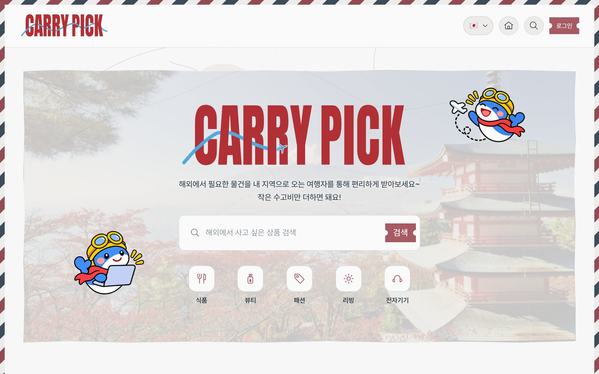
</p>

```
carrypick/
├── backend/    Spring Boot REST API (Java 21, JPA, Spring Security + JWT)
├── frontend/   React 18 + Vite + TypeScript (모바일 우선 웹앱)
└── docs/       README에 쓰인 화면 캡처
```

## 바로 체험하기

설치 없이 **<https://carrypicks.vercel.app/>** 에서 바로 사용해 볼 수 있습니다.

1. 사이트를 열면 **로그인 없이** 상품을 둘러볼 수 있어요.
2. 상품의 **예약하기**를 누르거나 오른쪽 위 **로그인**을 누르면 로그인 창이 열립니다.
3. 로그인 창에서 **민지 (구매자) 계정으로 계속하기**를 누릅니다.
4. 브라우저의 **시크릿 창**(Chrome: `Ctrl/⌘ + Shift + N`)을 하나 더 열고 같은 주소에서 **켄지 (여행자) 계정으로 계속하기**를 누릅니다.
5. 두 창을 나란히 놓고 구매자와 여행자 역할을 오가며 아래 [사용 흐름](#사용-흐름)을 따라 해 보세요.

> 미디어 프로젝트 수업 때문에 보고 계신 분은 **회원가입 대신 데모 계정**으로 로그인해 주세요. 회원가입을 누르면 데모 계정 안내 창이 나옵니다.

결제는 토스페이먼츠 **테스트 결제창**으로 진행되며 실제 돈은 나가지 않습니다. 데모 서버는 다시 시작될 때 데이터가 초기화될 수 있습니다.

## 화면 둘러보기

### 1. 로그인 없이 둘러보기

홈에서 나라와 카테고리를 고르고, 여행자들이 사 오는 상품을 볼 수 있어요. 상품 화면에서는 여행 일정, 도착 예정일, 수고비와 총 결제 금액을 미리 확인할 수 있습니다.

<table>
  <tr>
    <td align="center">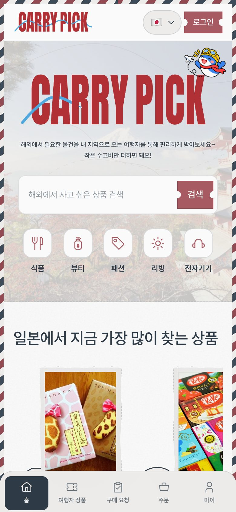</td>
    <td align="center">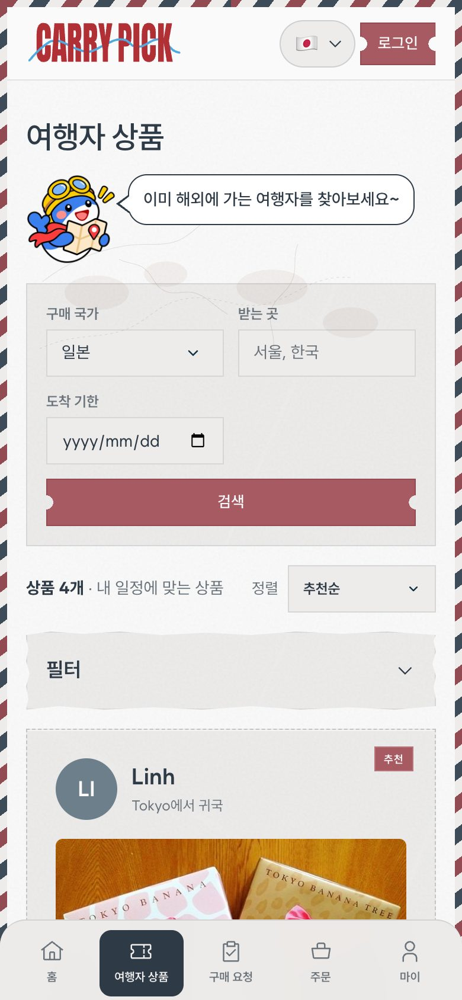</td>
    <td align="center">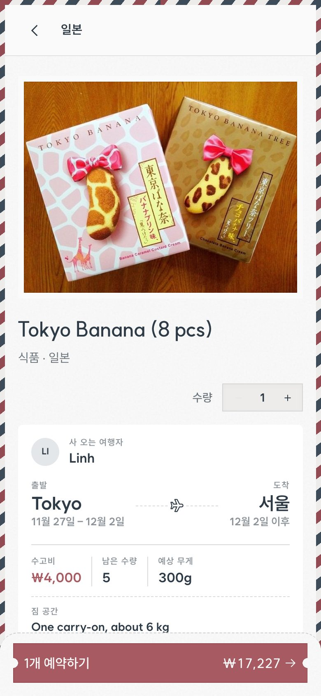</td>
  </tr>
  <tr>
    <td align="center"><b>홈</b><br>인기 상품, 카테고리, 검색</td>
    <td align="center"><b>여행자 상품</b><br>나라·도착일로 찾기</td>
    <td align="center"><b>상품 상세</b><br>여행 일정과 가격 확인</td>
  </tr>
</table>

### 2. 주문할 때 로그인 · 나라와 언어 선택

로그인 페이지로 이동하지 않고, 주문하려는 순간 **로그인 창**이 떠요. 로그인하면 바로 주문 확인으로 이어집니다. 오른쪽 위 국기 버튼에서는 **나라**와 **언어**(한국어, English, 日本語, Tiếng Việt, Bahasa Indonesia)를 고를 수 있어요.

<table>
  <tr>
    <td align="center">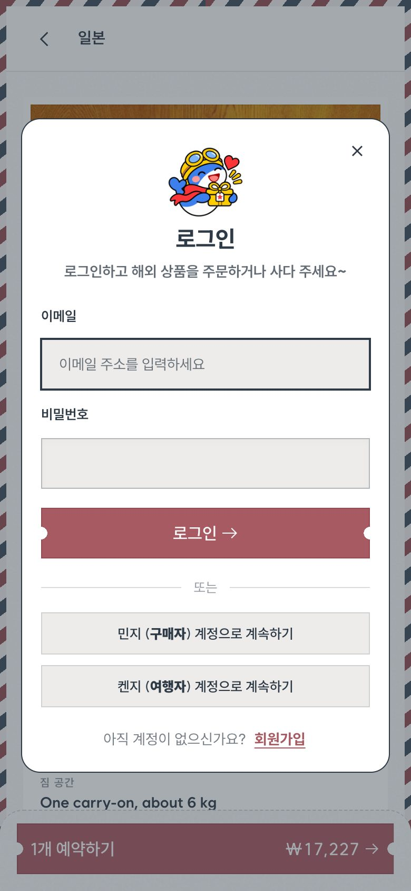</td>
    <td align="center">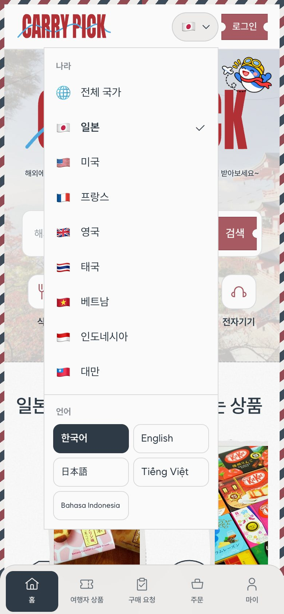</td>
  </tr>
  <tr>
    <td align="center"><b>로그인 창</b><br>데모 계정으로 바로 로그인</td>
    <td align="center"><b>나라 · 언어 선택</b><br>5개 언어 지원</td>
  </tr>
</table>

### 3. 구매자: 요청하고 주문 확인하기

원하는 상품이 없으면 **구매 요청**을 올려요. 현지 통화로 예산을 적으면 원화로 바꿔 보여 줍니다. 주문이 들어가면 진행 상황을 단계별로 확인하고 여행자와 채팅할 수 있어요.

<table>
  <tr>
    <td align="center">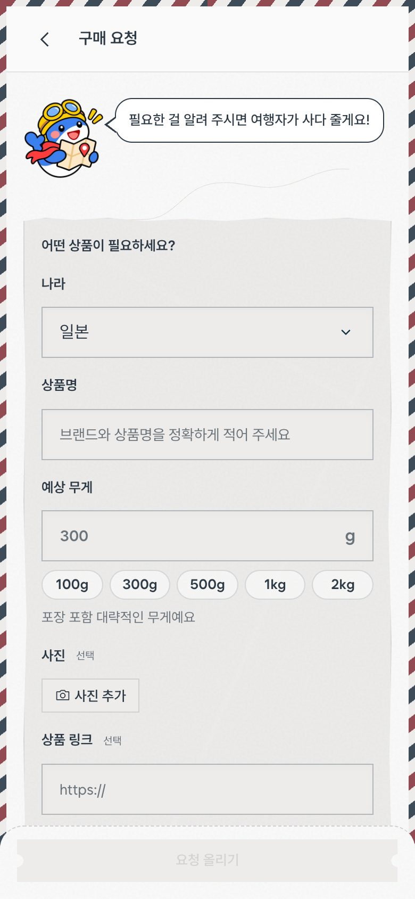</td>
    <td align="center">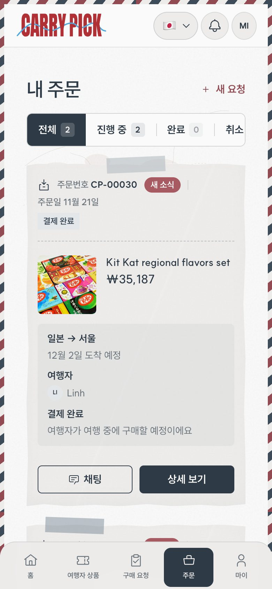</td>
    <td align="center">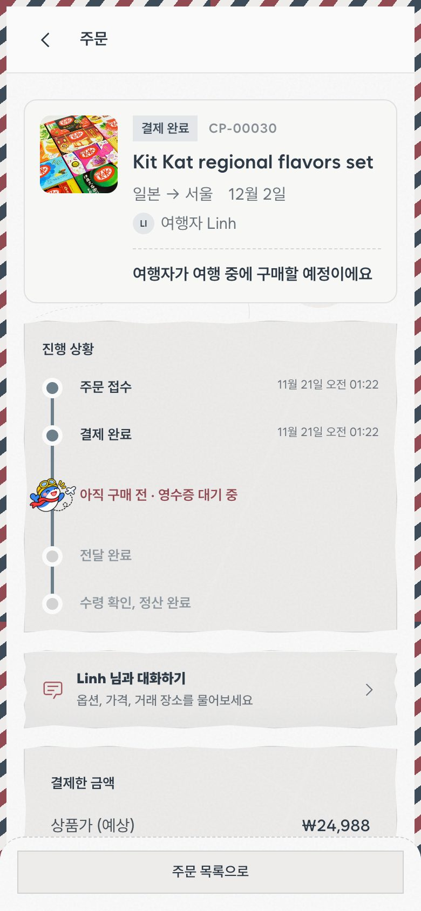</td>
  </tr>
  <tr>
    <td align="center"><b>구매 요청</b><br>상품, 예산, 수고비 입력</td>
    <td align="center"><b>내 주문</b><br>주문별 상태와 채팅</td>
    <td align="center"><b>주문 상세</b><br>단계별 진행 상황</td>
  </tr>
</table>

### 4. 여행자: 요청 받고 수고비 받기

여행자는 내 여행 국가와 날짜에 맞는 구매 요청을 보고 수락해요. 마이페이지에서 여행 등록, 상품 올리기, 정산 금액과 정산 계좌를 관리합니다.

<table>
  <tr>
    <td align="center">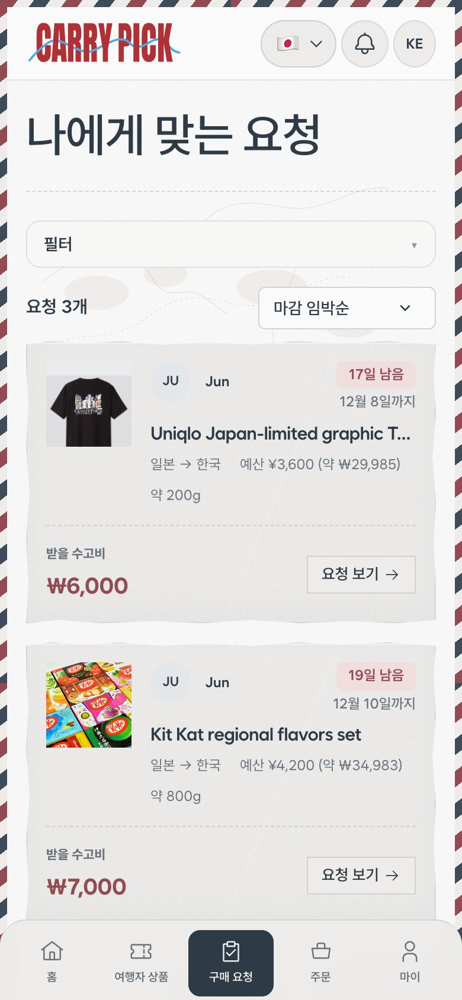</td>
    <td align="center">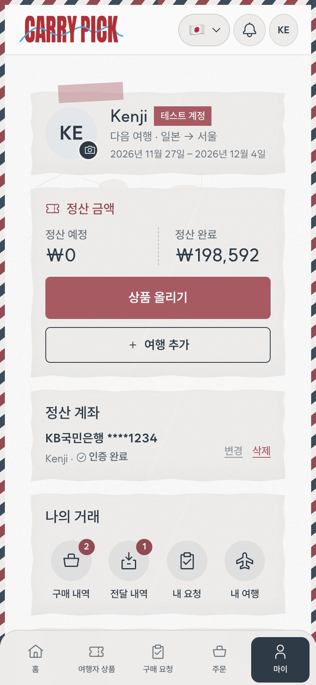</td>
  </tr>
  <tr>
    <td align="center"><b>나에게 맞는 요청</b><br>받을 수고비와 마감일</td>
    <td align="center"><b>마이페이지</b><br>정산 금액, 여행, 거래 내역</td>
  </tr>
</table>

## 주요 기능

**구매자**
- 로그인 없이 상품 둘러보기: 홈의 인기 상품 순위, 카테고리, 검색과 필터(나라, 도착일, 가격)
- 주문할 때 뜨는 로그인 창, 로그인 후 바로 주문 이어서 진행
- 여행자 상품 예약과 결제 (모의 결제 또는 토스페이먼츠 테스트 결제)
- 구매 요청 올리기와 수정: 현지 통화 예산(예: ¥3,600)을 입력하면 요청을 올린 날의 환율로 원화가 고정돼요
- 주문 진행 현황 확인, 여행자와 채팅(사진 전송 가능)
- 예산 초과 시 추가 금액 승인, 상품 수령 확인, 문제 신고
- 전달 후 일정 기간(기본 3일) 동안 확인이 없으면 자동으로 수령 확인

**여행자**
- 여행 등록, 여행지에서 사 올 상품 올리기
- 나에게 맞는 구매 요청 보기(여행 국가·날짜 기준)와 수락
- 구매 후 영수증 사진 올리기: AI가 영수증의 금액과 통화를 읽어 입력을 도와줘요
- 전달 완료 처리, 수고비 정산 계좌 등록

**공통**
- 5개 언어: 한국어, English, 日本語, Tiếng Việt, Bahasa Indonesia (오른쪽 위 국기 버튼 또는 마이페이지)
- 알림, 환율 표시(현지 통화와 원화를 함께 표시)
- 휴대폰·태블릿·노트북 화면에 맞춘 반응형 화면

## 환경

| 항목 | 버전 |
| --- | --- |
| Java | 21 이상 |
| Maven | 3.9 이상 (IntelliJ에 포함된 Maven도 가능) |
| Node.js | 20 이상 |
| 데이터베이스 | 기본: H2 메모리 DB (설치 불필요) / 선택: PostgreSQL |

사용 포트: API `8080`, 웹앱 `5173`

## 설치

```bash
git clone https://github.com/reohsgw/Carrypicks.git
cd Carrypicks

# 웹앱 패키지 설치
cd frontend
npm install
```

백엔드는 처음 실행할 때 Maven이 필요한 라이브러리를 자동으로 내려받습니다.

## 실행 방법

**1. API 서버 실행** (포트 8080)

```bash
cd backend
mvn spring-boot:run
```

기본 설정은 H2 메모리 DB와 데모 데이터를 사용하므로 따로 설정할 것이 없습니다. 서버를 다시 시작하면 데이터가 초기화됩니다. API 문서: <http://localhost:8080/swagger-ui.html>

**2. 웹앱 실행** (포트 5173, 새 터미널에서)

```bash
cd frontend
npm run dev
```

<http://localhost:5173> 을 엽니다. 휴대폰 화면은 브라우저 개발자 도구의 기기 모드로 볼 수 있습니다.

**3. 테스트 계정으로 로그인** (비밀번호는 모두 `carrypick123`)

| 이메일 | 역할 |
| --- | --- |
| buyer@carrypick.test | 구매자 (민지) |
| buyer2@carrypick.test | 구매자 (준) |
| traveler@carrypick.test | 여행자 (켄지) |
| traveler2@carrypick.test | 여행자 (린) |

로그인 창의 **민지 (구매자)**, **켄지 (여행자)** 버튼으로 바로 로그인할 수 있습니다. 브라우저 탭마다 로그인이 따로 유지되므로, 한 탭은 구매자, 다른 탭은 여행자로 동시에 사용할 수 있습니다.

**선택 설정** (API 서버 실행 시 환경 변수로 지정)

| 변수 | 값 | 설명 |
| --- | --- | --- |
| `PAYMENT_MODE` | `mock`(기본) / `toss` | `toss`는 `TOSS_CLIENT_KEY`, `TOSS_SECRET_KEY`(테스트 키) 필요. 실제 돈은 결제되지 않아요 |
| `AI_PROVIDER` | `mock`(기본) / `gemini` / `anthropic` | 영수증 읽기. `GEMINI_API_KEY` 또는 `ANTHROPIC_API_KEY` 필요 |
| `PORT` | 숫자 | 8080 포트가 이미 사용 중일 때 (웹앱은 `API_PORT=같은 숫자 npm run dev`) |

```bash
# 예: 토스 테스트 결제 + Gemini 영수증 읽기
PAYMENT_MODE=toss TOSS_CLIENT_KEY=test_ck_xxx TOSS_SECRET_KEY=test_sk_xxx \
AI_PROVIDER=gemini GEMINI_API_KEY=xxx mvn spring-boot:run
```

PostgreSQL을 쓰려면: `mvn spring-boot:run -Dspring-boot.run.profiles=postgres` (`DB_URL`, `DB_USER`, `DB_PASSWORD` 설정). 배포 방법은 [DEPLOY.md](DEPLOY.md)를 참고하세요.

테스트 실행: `cd backend && mvn test`

## 사용 흐름

**흐름 A: 여행자 상품 예약하기**

1. 구매자: 홈 또는 **여행자 상품**에서 상품 선택 → **예약하기** → (로그인 창에서 로그인) → 결제
2. 여행자: **주문** → 해당 주문 → **구매 완료 · 영수증 올리기** → 영수증 사진 첨부 → **영수증 확인**(AI가 금액을 채워 줌) → 확인 후 저장
3. 여행자: 한국에 돌아와 상품 전달 → **전달 완료하기**
4. 구매자: 주문 → **상품 받았어요** → 수고비 정산 완료

**흐름 B: 구매 요청이 수락되고 예산을 넘는 경우**

1. 구매자: **구매 요청** → 나라·상품·현지 통화 예산·수고비 입력 → **요청 올리기** (올린 뒤에도 **요청 수정** 가능)
2. 여행자: **구매 요청** → 요청 선택 → 여행 선택 → **수락하기**
3. 구매자: 주문 → 결제
4. 여행자: 예산보다 비싸면 **예상보다 비싸요**로 가격표 사진을 보내거나, 더 비싼 금액으로 구매 완료 등록
5. 구매자: 추가 금액 승인 및 결제
6. 여행자 전달 → 구매자 수령 확인 → 정산 완료

구매자와 여행자는 주문 화면의 **대화하기**로 채팅할 수 있고, 문제가 있으면 **문제 신고**를 할 수 있습니다. 신고하면 해결될 때까지 정산과 자동 수령 확인이 멈춥니다.
